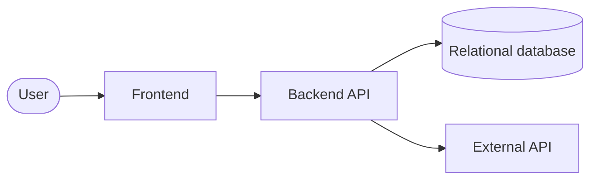
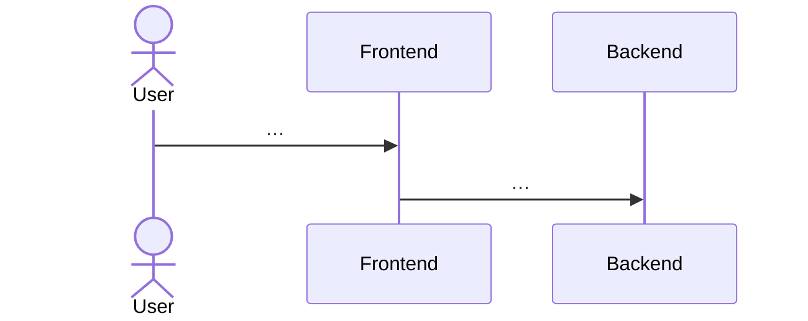

# Software design document

> **Living document**, five pages or fewer, mostly diagrams as code (Mermaid renders on GitHub). First draft due before Class 5; tagged `design-v1` by Class 6. Significant decisions get an ADR in [adr/](adr/).

## 1. Architecture

C4 context and container views.

## 2. Key decisions (ADRs)

At least two, including the stack choice that cites your Technology Stack Analysis.

- [ADR 0001: Record architecture decisions](adr/0001-record-architecture-decisions.md)
- ADR 0002: Choice of stack (…)

## 3. UML

- Class or ER diagram
- One or two sequence diagrams for the core flows

## 4. API contract

Link the OpenAPI file (e.g., `backend/openapi.yaml`) or list the endpoints with request and response examples.

## 5. Data model

Entities, relationships and key constraints (unique, foreign keys, checks), plus a short note on why this database.

## 6. External API

Which API, the team's own interface around it, and how tests replace it with a stub.

## 7. Cross-cutting concerns

Authentication and authorisation, error handling, logging, configuration and secrets, testing strategy.

## 8. Run and deploy

Local setup (Docker Compose from Class 8) and the free host used for deployment.
